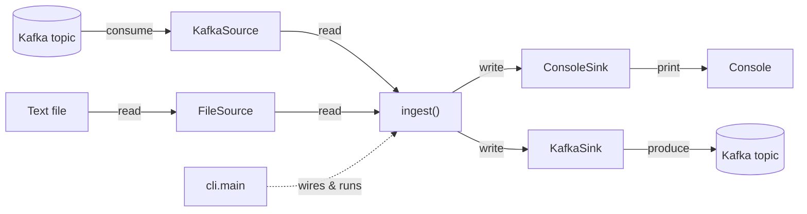

# Architecture

Ingestor follows the **ports and adapters** (hexagonal) style:

- **Ports** (`ingestor.ports`) are the interfaces and the domain model. They know
  nothing about any tool.
- **Adapters** (`ingestor.adapters.*`) are concrete implementations. Each tool
  lives in its own folder.
- **The use case** (`ingest`) talks only to the ports.
- **The Composition Root** (`cli.py`) is the only place that picks the concrete
  classes and injects them.

## Flow



[Open the interactive diagram](diagrams/ingestor-architecture.html){ target=_blank }
for a richer, explorable version.

## Ports

| Port | Contract |
|---|---|
| `Source` | `read() -> Iterator[Record]`, `close()` |
| `Sink` | `write(record)`, `close()` |
| `Connection` | `source()`, `sink()` |
| `Record` | domain model: `value`, `key`, `origin` |

## Why it matters

- **Dependency inversion.** `ingest` depends on abstractions, never on
  `confluent_kafka`.
- **Open/closed.** A new tool is added by writing a new adapter - the use case is
  untouched.
- **Testable without infrastructure.** In-memory fakes implement the same ports,
  so the full flow runs without Docker or a broker.

## Layers at a glance

```text
src/ingestor/
├── app.py              # ingest(source, sink, limit)
├── cli.py              # Composition Root
├── ports/              # interfaces + domain (tool-agnostic)
└── adapters/           # concrete implementations (one folder per tool)
    ├── kafka/          # streaming
    ├── console/        # stdout
    └── batch/          # file
```
